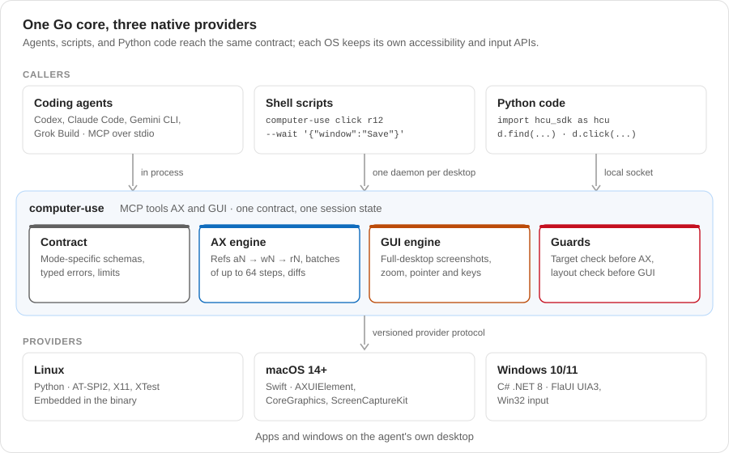

<div align="center">

# Hybrid Computer Use

### A Unified Programmatic, Semantic, and Visual Interface for General Agents

[Haoqing Wang](https://github.com/hqhq1025)<sup>1*</sup> · Xiaoyi Zhang<sup>1†</sup> · Sicheng Fan<sup>2</sup> · Zhexin Zhang<sup>3</sup> · Xinjie Zhang<sup>1</sup> · Jiahao Li<sup>1</sup> · Bin Li<sup>1</sup> · Yan Lu<sup>1</sup>

<sup>1</sup>Microsoft Research &emsp; <sup>2</sup>Fudan University &emsp; <sup>3</sup>Tsinghua University

[](https://microsoft.github.io/Hybrid-Computer-Use/)
[](paper/Hybrid-Computer-Use.pdf)
[](https://github.com/microsoft/Hybrid-Computer-Use/actions/workflows/ci.yml)


[](LICENSE)

[Paper](paper/Hybrid-Computer-Use.pdf) · [Results](#results) · [See it work](#see-it-work) · [How it works](#how-it-works) · [Quick start](#quick-start) · [Docs](docs/README.md) · [Citation](#citation)

</div>

<p align="center">
  
</p>

**Hybrid Computer Use (HCU)** is an open-source MCP server, `computer-use`,
that lets coding agents such as Codex, Claude Code, Gemini CLI, and Grok Build
operate Linux, macOS, and Windows desktops. It adds two tools, `AX` and `GUI`,
next to the agent's own shell and file tools, so the agent picks the right
channel at each step:

| Channel | Tool | What the agent does with it |
| --- | --- | --- |
| Programmatic | the agent's shell and file tools | Edit files, query data, run command-line tools |
| Semantic | `AX` | Read a compact accessibility tree with short refs (`a1`, `w1`, `r12`), run up to 64 actions in one call with waits, and get back a diff |
| Visual | `GUI` | Take full-desktop screenshots, zoom into dense regions, and send batched pointer and keyboard input |

Before it sends any input, HCU checks the live target of every `AX` action and
the live window layout of every `GUI` coordinate. An action planned on a
desktop that has since changed is rejected, not sent.

## Results

Each comparison keeps the model, agent harness, tasks, and step budget fixed
and changes only the computer-use interface. The baseline is
[CUA Driver](https://github.com/trycua/cua).

| Benchmark | Platform | Model | HCU | CUA Driver | Cost |
| --- | --- | --- | ---: | ---: | ---: |
| OSWorld 2.0 (108 tasks) | Linux | GPT-6 Astra | **72.37%** Partial | 68.82% | about the same |
| OSWorld 1.0 (360 tasks) | Linux | GPT-5.4 | **70.13%** | 62.47% | **−59.1%** |
| Windows Agent Arena (111 tasks) | Windows | GPT-5.4 | **80.86%** | 71.89% | **−50.6%** |
| MacAgentBench, UI subset (28 tasks) | macOS | GPT-5.4 | **25 / 28** | 24 / 28 | **−51.4%** |
| WeaveBench (114 tasks) | Linux | GPT-5.4 | **53.25%** | 46.37% | **−46.3%** |

- On OSWorld 2.0, HCU with Claude Opus 5 reaches **35.19% Binary**, the highest
  of all full-set systems, at 20.3% lower cost than the official GUI loop.
- On OSWorld 1.0 with four frontier models (GPT-5.4, Claude Opus 5.5,
  Gemini 3.8 Flash, Grok 4.7), HCU raises the mean score by 6.48 points with
  17% fewer Steps and 30% lower cost.

## See it work

The same Calc task through three interfaces, on one clock. HCU reads the
dialog, batches four changes through AX, zooms with GUI to check the red
negative format, then clicks OK and waits for the dialog to close.

<p align="center">
  
</p>

When one channel changes the desktop, the other channel's stale plan is
caught before it clicks the wrong control.

<p align="center">
  
</p>

## How it works

<p align="center">
  
</p>

One Go core implements the contract once. Coding agents call it over MCP;
shell scripts and Python code share one daemon per desktop. Each operating
system has its own provider for accessibility, screenshots, and input.

An `AX` call batches known steps and waits inside the call:

```json
{
  "mode": "act",
  "actions": [
    {"type": "click", "ref": "r12"},
    {"type": "wait", "window": "Export"},
    {"type": "type", "text": "q3.csv"},
    {"type": "keypress", "keys": ["ENTER"]}
  ]
}
```

Every `AX` and `GUI` result starts with one JSON status line (`ok`, `code`,
`hint`, `input_emitted`, `completed`), followed by the effect on each target,
the open windows, and a compact AX diff or a screenshot.

## Quick start

### 1. Build

```bash
make build-local   # Linux binary in artifacts/computer-use (Go 1.22+)
make smoke         # check that stdio MCP exposes AX and GUI
make build-macos   # macOS bundle in artifacts/macos/ (Swift 6.2+)
make build-windows # Windows bundle in artifacts/windows/ (.NET 8, PowerShell 7)
```

Run `artifacts/computer-use doctor` as the signed-in desktop user to check
permissions and dependencies. See [Native platforms](docs/PLATFORMS.md).

### 2. Connect an agent

**Codex** (`~/.codex/config.toml`):

```toml
[mcp_servers.computer_use]
command = "/abs/path/to/artifacts/computer-use"
args = ["mcp"]
startup_timeout_sec = 60
tool_timeout_sec = 180
```

**Claude Code**:

```bash
claude mcp add computer_use -- python3 \
  /abs/path/to/hcu/osworld/guest_files/claude_mcp_schema_adapter.py \
  /abs/path/to/artifacts/computer-use mcp
```

`python3 -m hcu.render_agent_config` writes complete configurations, with
`instructions/base.md` and `instructions/hybrid.md`, for Codex, Claude Code,
Gemini CLI, and Grok Build. See [Computer Use MCP](docs/MCP.md).

HCU sends real input to the signed-in desktop. Use a dedicated desktop or a
disposable VM for untrusted tasks.

### 3. Or drive it from the shell and Python

The CLI and the Python SDK share one daemon per desktop, so refs carry over
between them:

```bash
computer-use apps                                    # list windows (w1, w2, ...)
computer-use find w1 --role button --name-has Save   # find refs (r12, ...)
computer-use click r12 --wait '{"window":"Save"}'    # act, then wait for a window
computer-use gui screenshot                          # full-desktop screenshot
computer-use gui zoom 600 60 680 100                 # enlarge a region
```

```python
import hcu_sdk as hcu  # PYTHONPATH=sdk/python

d = hcu.connect()
w = d.apps().windows[0].ref
save = d.find(w, role="button", name_contains="Save").matches[0]
d.click(save.ref, wait={"window": "Save"})
```

See [Code entry points](docs/CODE.md) for async use and programmatic tool calling.

## Platform support

| OS | Native provider | Evaluated on |
| --- | --- | --- |
| Linux (X11) | Python, embedded in the binary: AT-SPI2, X11, XTest | OSWorld 1.0 and 2.0, WeaveBench |
| macOS 14+ | Swift: AXUIElement, CoreGraphics, ScreenCaptureKit | MacAgentBench |
| Windows 10/11 | C# .NET 8: FlaUI UIA3, Win32 | Windows Agent Arena |

## Documentation

Start with the [documentation guide](docs/README.md), or go straight to a topic:

| Guide | Read it to |
| --- | --- |
| [Computer Use MCP](docs/MCP.md) | Build and run the server, connect agents, and look up the `AX` and `GUI` contract and errors |
| [Code entry points](docs/CODE.md) | Use the daemon, the CLI, the Python SDK, and programmatic tool calling |
| [Native platforms](docs/PLATFORMS.md) | Set up Linux, macOS, and Windows permissions and providers |
| [Running OSWorld](docs/OSWORLD.md) | Reproduce the OSWorld 1.0 and 2.0 evaluations |
| [Architecture](docs/ARCHITECTURE.md) | Change the code: packages, request path, and state models |

## FAQ

<details>
<summary><b>What is Hybrid Computer Use?</b></summary>

HCU is a computer-use interface for general coding agents. It is an MCP server
with two tools: `AX` reads and acts on the accessibility tree, and `GUI` works
with screenshots and pointer and keyboard input. The agent keeps its own shell
and file tools, so one agent can mix code, accessibility, and pixels in a
single task.
</details>

<details>
<summary><b>How is HCU different from a screenshot-only computer-use loop?</b></summary>

A screenshot loop sends a full image at every step and acts only through
pixels. HCU lets the agent act on named controls by ref, batch up to 64
actions in one call, read back only a diff, and use screenshots only when
pixels matter. Agents keep a stable, cacheable context.
</details>

<details>
<summary><b>How does HCU compare with CUA Driver and Codex Computer Use?</b></summary>

Those drivers also act through the accessibility tree, but one action per call
and in the background of a shared desktop. HCU targets a desktop the agent
has to itself: it batches actions with in-call waits, returns diffs, and checks
the live target and layout before input. With the same model and harness, HCU
scores higher at lower cost (see [Results](#results)).
</details>

<details>
<summary><b>Which agents and operating systems does it support?</b></summary>

Any MCP client can use it. The repository ships configurations for Codex,
Claude Code, Gemini CLI, and Grok Build. Providers exist for Linux (X11),
macOS 14+, and Windows 10/11.
</details>

<details>
<summary><b>How do I reproduce the paper's OSWorld results?</b></summary>

Follow [Running OSWorld](docs/OSWORLD.md). Each task runs in a fresh
Docker/QEMU guest with one agent and one MCP process, and the official
evaluator scores the result.
</details>

## Citation

The paper is in [paper/Hybrid-Computer-Use.pdf](paper/Hybrid-Computer-Use.pdf).

```bibtex
@article{wang2026hcu,
  title   = {Hybrid Computer Use: A Unified Programmatic, Semantic, and Visual Interface for General Agents},
  author  = {Haoqing Wang and Xiaoyi Zhang and Sicheng Fan and Zhexin Zhang and Xinjie Zhang and Jiahao Li and Bin Li and Yan Lu},
  year    = {2026}
}
```

## Contributing and license

Run `make test` before you open a pull request. [CONTRIBUTING.md](CONTRIBUTING.md)
explains the contract golden tests and layout rules.

HCU is released under the [MIT License](LICENSE). Files adapted from
OSWorld-V2 remain under Apache 2.0; see [THIRD_PARTY_NOTICES.md](THIRD_PARTY_NOTICES.md).
