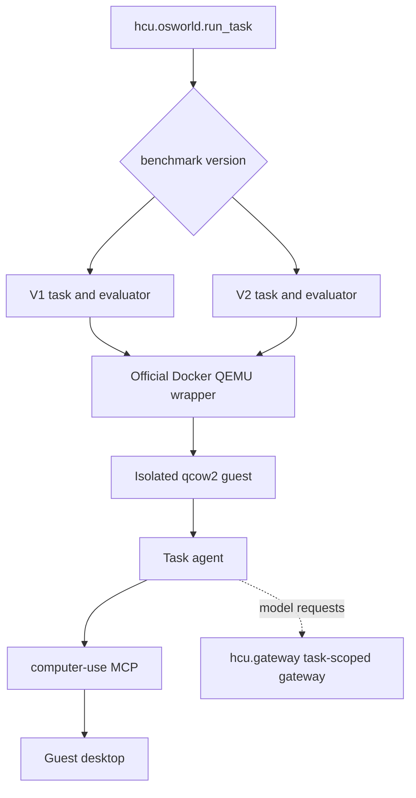
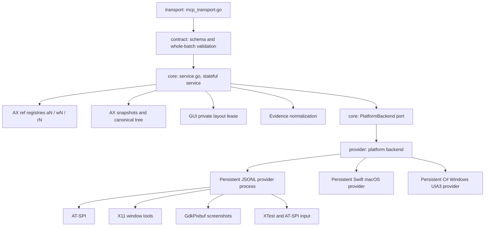

# Architecture

This page is for contributors. It shows how a request travels from an agent
to the desktop, which Go package owns each step, and how the AX and GUI
state models keep refs and coordinates safe. To use HCU, start with
[Computer Use MCP](MCP.md).

<p align="center">
  
</p>

## Control plane

The OSWorld runner creates one isolated desktop per task, installs one task
agent and lets that agent start one `computer-use mcp` child over stdio. No
MCP state is shared across tasks.

OSWorld V1 and OSWorld-V2 runs share the official Docker/QEMU backend. The
benchmark version selects the task and evaluator generation, not the
virtualization.



Every task agent receives the original OSWorld instruction plus a minimal
runner contract for `TASK_COMPLETE`, `TASK_INFEASIBLE` and `ASK_USER`. The four
supported agents (Codex, Claude Code, Gemini CLI and Grok Build) also receive
the same base safety and outcome policy and selected interaction guide as
plain text through their own context routes. These files are always injected,
not discovered or activated as skills; omitting the profile keeps the base.
[Running OSWorld](OSWORLD.md#isolation-and-instructions) lists the delivery
routes and defines the separation from runner markers.

## MCP process



The main boundaries (paths are relative to `computer-use/`):

1. `internal/contract/tool_contract.go` publishes the server instructions and
   the strict, mode-specific JSON schemas; `internal/core/tool_arguments.go`
   parses arguments.
2. `internal/core/service.go` routes calls, owns session state and captures
   error context.
3. `internal/core/ax_*.go` implements the canonical AX state, compact working
   projections, references, action guards, wait checks and evidence.
4. `internal/core/gui_service.go` validates GUI batches and binds coordinates
   to the last screenshot.
5. `internal/core/platform_contract.go` and `internal/core/provider_*.go`
   define the private, versioned provider protocol;
   `internal/provider/runtime_backend_<os>.go` and the platform transports
   implement it and run the provider process.
6. `native/linux/provider/` implements AT-SPI, X11, screenshots and input in
   Python. The binary embeds it and writes it to disk when it starts the
   provider process.
7. `native/macos/` and `native/windows/` implement native accessibility,
   screenshot and input mechanisms. Their app/executable is packaged beside
   the Go binary. A native worker is never shared between MCP processes.

macOS also implements the optional private ordered-keyboard operation. The
Go service still validates the whole public batch, binds one logical window,
and consumes per-action continuity and emission evidence. Other providers use
the existing per-action path. Provider argument rejection is distinct from a
transport failure and does not imply input or restart a healthy worker.

Application discovery responses can include `inventory_issues`, a list of
`{app, reason}` objects. An omitted `app` means application enumeration itself
was incomplete. Known windows remain usable, but the Go core permits partial
inventories only for `AX mode=apps`. Title selection, implicit focus, and
window waits require a complete inventory. Missing windows never prove absence.
Linux retains its existing human-readable notes alongside these typed facts.
Native window-close verification uses its separate exact-window evidence.

## Go packages

The Go module in `computer-use/` has six packages. Arrows point from a
package to the packages it imports; a package never imports one above it.

```text
cmd/computer-use (main)      main(): copies -X main.version into contract,
        |                    runs the CLI, links the provider for its init()
        v
internal/transport           MCP stdio, daemon socket, CLI
        |
        v
internal/provider            platform backends: Linux executor,
        |                    darwin and windows sidecar transports
        v
internal/core                service, AX, GUI, registries, results,
        |                    and the platform port it consumes
        v
internal/contract            published schemas, validation, public error
        |                    codes and limits, describe document
        v
computer-use/ (runtimebundle) go:embed of runtime.py and native/linux/provider
```

| Package | Directory | Owns | Does not own |
| --- | --- | --- | --- |
| `contract` | `internal/contract` | `tool_contract.go` (tool definitions, input schemas, server instructions), `schema_validator.go` (schema validation and explanations), `tool_argument_rules.go` (tool-specific error wording), `published_values.go` (public modes, action types, error codes, limits, defaults), `contract_describe.go` (`DescribeContract`, `PublicErrorCodes`, `ContractVersion`, `ServerVersion`) | Result construction, state, I/O |
| `core` | `internal/core` | `service.go` (`Service`, `DesktopState`, `sessionState`, `callTool`), `service_entry.go` (calls from the CLI), `ax_*.go`, `gui_service.go`, `app_snapshot.go`, `records.go`, `tool_result.go`, `argument_errors.go`, `request_replay.go`, `mcp_session_state.go`, `ax_public_request.go` (AX decoder), the platform port (`platform_contract.go`, `provider_types.go`, `provider_wire.go`, the other `provider_*.go` contracts), `platform_default.go` (backend hook), `runtime_backend_unsupported.go`, key preflight for macOS and Windows | Processes, sockets, platform calls |
| `provider` | `internal/provider` | `runtime_backend_{linux,darwin,windows}.go` (each installs the backend hook in `init()`), `linux_runtime_executor.go`, `linux_host_runtime.go`, `linux_runtime_bundle.go`, `darwin_sidecar_transport.go`, `darwin_timeout_diagnostic.go`, `windows_sidecar_transport*.go`, `windows_parent_death_*.go`, `provider_sidecar_buffer.go`, `provider_diagnostic_line.go`, `file_owner_*.go` | Wire types and validation (they are the port, in core) |
| `transport` | `internal/transport` | `mcp_transport.go`, `mcp_attach.go`, `daemon.go`, `daemon_client.go`, `daemon_spawn_*.go`, `peer_cred_*.go`, `cli.go`, `cli_main.go` (`RunCLI`, `call`, help, `doctor` notes) | Argument meaning, error meaning |
| `main` | `cmd/computer-use` | `main.go`: `version`, `main()` | Everything else |
| `runtimebundle` | `computer-use/` | `runtime_bundle_fs.go`: the `embed.FS` of the Linux provider | Bundle selection (`internal/provider/linux_runtime_bundle.go`) |

Three choices keep the dependency direction one-way:

1. Core owns the platform port. Core consumes `PlatformBackend` and the
   `Provider*` request and result types, and the provider implements them.
   Six of these types are aliases of core snapshot types
   (`ProviderSnapshot = AppSnapshot`). The wire envelope and its validation
   sit with them, so the provider package only moves bytes and runs processes.
2. Core selects the backend through a hook. `platform_default.go` declares
   `DefaultRuntimeBackend` and `ShutdownPlatformRuntime` with the unsupported
   backend and a no-op; each `runtime_backend_<os>.go` replaces them in
   `init()`, and `cmd/computer-use` imports the provider package for that
   `init()`. Core tests therefore run against the unsupported backend unless
   a test injects a backend.
3. go:embed cannot reach a parent directory, so a one-file package at the
   module root declares the embedded Linux provider (`runtime.py`,
   `native/linux/provider/*.py`).

The release version is still set with `-X main.version=...`; `main()` copies
it into `contract.ServerVersion` before any command runs. Build scripts build
`./cmd/computer-use`.

### Request path

```text
MCP / daemon / CLI (transport)
  -> core.Service callTool(name, args)    transport calls exported wrappers
       -> contract.ValidateToolArguments      schema check, explanations
       -> core decoder (ax_public_request.go) cross-field rules
       -> AX or GUI service (ax_*.go, gui_service.go)
            -> core platform port (PlatformBackend)
                 -> provider backend -> provider process (Python, Swift, C#)
       -> core rendering (tool_result.go, ax_evidence.go, records.go)
  <- tool result or records
```

### To change an interface, edit these files

Paths are relative to `computer-use/`. Each list ends with the checks that
prove the change; `scripts/maint/check_all.sh` runs the full check list.

A public tool field, mode or action type (model-visible):

1. `internal/contract/tool_contract.go`: schema property, description,
   server instructions.
2. `internal/contract/published_values.go`: the enum or limit, if it is a
   published value.
3. `internal/core/ax_public_request.go`: decoder rule, rejection path and hint.
4. The `internal/core/` file that implements the behaviour (`ax_request.go`,
   `ax_batch*.go`, `ax_wait.go`, `ax_find*.go`, `gui_service.go`).
5. `internal/transport/cli.go`: `cliShorthands`, if the CLI exposes it.
6. `../sdk/python/hcu_sdk/`: helper, if the SDK exposes it.
7. Docs: `docs/MCP.md`, `instructions/hybrid.md`.
8. Golden: `go test ./internal/transport -run TestPublicContractMatchesGolden
   -update-contract`, then review `testdata/contract/public_contract.json`.
9. Checks: `TestCLIShorthandsProduceSchemaValidCalls`,
   `TestAXDecoderAcceptedCallsPassTheSchema`, `schema_consistency_test.go`,
   `sdk/python/tests/test_sdk.py` (through `TestPythonSDKAgainstDaemon`).

A public error code or hint:

1. `internal/contract/published_values.go`: the code constant.
2. `internal/contract/contract_describe.go`: `PublicErrorCodes` entry
   (meaning, retry advice).
3. `internal/core/ax_public_request.go`: `axPublicErrorCodes`.
4. `internal/core/ax_evidence.go`: `axPublicHints`.
5. `internal/transport/cli.go`: exit status mapping, if it differs.
6. `../sdk/python/hcu_sdk/__init__.py`: the exception class comes from the
   code name; edit only if the name breaks that rule.
7. Docs: `docs/MCP.md`, `instructions/hybrid.md` (checked by
   `TestPublicErrorCodesAreDocumented`).
8. Checks: `TestEveryPublicErrorCodeIsPublished`,
   `TestEveryPublicErrorCodeHasAHint`, the contract golden.

A provider wire field or operation (private protocol):

1. `internal/core/provider_types.go`: request or result type and JSON tag.
2. `internal/core/provider_wire.go`: envelope and validation.
3. `internal/core/provider_request_builder.go`: how core fills the request.
4. `internal/core/platform_contract.go`: `PlatformBackend` method, for a new
   operation.
5. `internal/provider/runtime_backend_{linux,darwin,windows}.go` and
   `internal/core/runtime_backend_unsupported.go`: each backend's method.
6. Test fakes of `PlatformBackend` in `internal/core/*_test.go`
   (`recordingPlatformBackend` in `helpers_test.go` and others) and in
   `internal/transport/daemon_test.go` and `transport_helpers_test.go`;
   `go vet ./...` lists every fake that misses the method.
7. Providers: `native/linux/provider/wire.py` and its users,
   `native/macos/Sources/ComputerUseProviderKit/` (validator, server),
   `native/windows/` (UIA3 provider).
8. Fixtures: `testdata/provider-wire/` (shared by Go, Swift and C# tests).
9. Checks: `TestProviderFixtureCorpus`, `TestProviderNativeFixtureCorpus`,
   `runtime_test.py`, Swift and .NET tests in CI.

A platform backend or sidecar transport:

1. `internal/provider/runtime_backend_<os>.go` and its transport file.
2. Shared pieces: `provider_sidecar_buffer.go`, `provider_diagnostic_line.go`.
3. Build tags: darwin and windows transports also build with
   `darwin_sidecar_test` and `windows_sidecar_test` on Linux; keep both
   configurations compiling.
4. Packaging: `native/macos/build.sh`, `native/windows/build.ps1`,
   `../Makefile`.
5. Checks: `go test -tags 'darwin_sidecar_test windows_sidecar_test' ./...`,
   `GOOS=darwin go vet ./...`, `GOOS=windows go vet ./...`,
   `TestDarwinBuildPackagesVersionedAdjacentApp`.

A Linux provider Python file:

1. The file under `native/linux/provider/`.
2. A new file: `internal/provider/linux_runtime_bundle.go`
   (`linuxProviderPaths`) and `internal/provider/linux_runtime_bundle_test.go`.
   The `go:embed` pattern in `runtime_bundle_fs.go` already covers
   `native/linux/provider/*.py`.
3. Checks: `runtime_test.py`, `TestLinuxRuntimeBundleIsComplete`.

Session or desktop state (refs, snapshots, cursors):

1. `internal/core/service.go`: `DesktopState` (shared by sessions on one
   desktop) or `sessionState` (one MCP or daemon session).
2. `internal/core/ax_ref_registry.go`, `ax_snapshot_store.go`,
   `ax_find_cursor.go`, `ax_failure_recovery.go`.
3. `internal/transport/daemon.go`, if the state must survive or be shared
   across daemon sessions (the daemon persists ref counters there).
4. Checks: `internal/core/service_state_test.go`,
   `TestDaemonSessionsAreSeparate`, `TestDaemonRestartNeverReusesRefNumbers`.

A transport (MCP, daemon, CLI):

1. `internal/transport/`: the adapter only builds arguments and prints or
   returns the core result; it does not validate or interpret.
2. `cmd/computer-use/main.go`, only for a new top-level process behaviour.
3. Checks: `TestCallOutputMatchesMCPToolResult`,
   `TestCLITextMatchesMCPOverTheDaemon`,
   `TestAttachedMCPMatchesInProcessAndSharesRefs`, and
   `scripts/maint/compare_mcp_bytes.py` against the previous binary for
   byte-identical `initialize`, `tools/list`, `help` and `schema`.

### Tests across packages

A test lives in the lowest package that can see everything it uses. Go does
not share `_test.go` declarations across packages, so transport tests that
need core fixtures use copies in `internal/transport/transport_helpers_test.go`
(names prefixed `transport`), and provider tests use
`internal/provider/provider_helpers_test.go`. When a core test helper changes,
update its copy.

Source-contract tests (`mainGoSource` in `internal/core/helpers_test.go`) read
every non-test Go file of the module, so moving code between packages does
not hide a fragment from them; a fragment that names a cross-package
identifier includes the package qualifier.

## AX state model

The server owns an identity graph:

```text
application aN -> logical top-level window wN -> element rN
```

References are short-lived capabilities, not selectors. Every mutation
resolves its reference against live canonical state. A reference becomes stale
when its exact target disappears or is replaced, and batches that would act
across windows fail before input.

The canonical AX tree stays complete. The model sees a compact working
projection that drops empty leaves and collapses neutral containers, while
`find`, selectors, references and actions keep querying canonical records.
An explicit observation root stays in that projection even without a label.
A root selected through a ref retains its resolved identity. Root protection
does not make hidden controls actionable or bypass action checks.

## GUI state model

GUI is full-desktop and not tied to an application. A screenshot establishes
a private layout lease. Before each coordinate action the provider checks the
window under that point against the lease. If that window changed, the action
is rejected before any input with `gui_frame_stale`, and a fresh screenshot
is returned.

AX `observe:"full"` and `observe:"screenshot"` return the same frame. The core
reads the tree, then captures the desktop through the GUI batch (one
`screenshot` action), and registers the delivered image as the current GUI
frame. A GUI coordinate action can follow an AX read directly and is checked
against that frame by the same point rule. Providers never capture a window
image.

Every provider scales the desktop to fit within 1366x768 and never enlarges
it. This is the size the model sees: GPT-5.4 at detail high shrinks a
1920x1080 image to 1365x768, so a larger image would put the model's
coordinates in a smaller space than the returned pixels. Coordinates are
pixels of the returned image. The provider maps them back to the native
desktop per axis, using the exact delivered width and height.

## Identity and distribution

Runtime fingerprints remain private implementation details. Providers use
them to distinguish window instances, detect layout changes and preserve exact
element identity when displayed names are truncated. Semantic snapshot
fingerprints support state comparison. These mechanisms are unrelated to
release selection.

Release and run selection uses explicit versions and functional checks rather
than project-enforced content-digest gates. Third-party downloads retain their
recorded SHA256 checks to reject corrupted or substituted archives before
installation. Provider diagnostics include bounded text, original byte counts
and truncation metadata.

## Evidence model

An accepted call is not task completion. Responses distinguish:

- validation failures before input;
- input that was not emitted;
- input that was or may have been emitted;
- semantic evidence from `wait` steps and AX reads;
- visual evidence from screenshots;
- stale state that requires a new observation.

AX cannot prove pixels, durable file contents, network state or evaluator
acceptance, and GUI cannot prove semantic identity or persistence. The agent
must pick the evidence source that matches the requested result.
