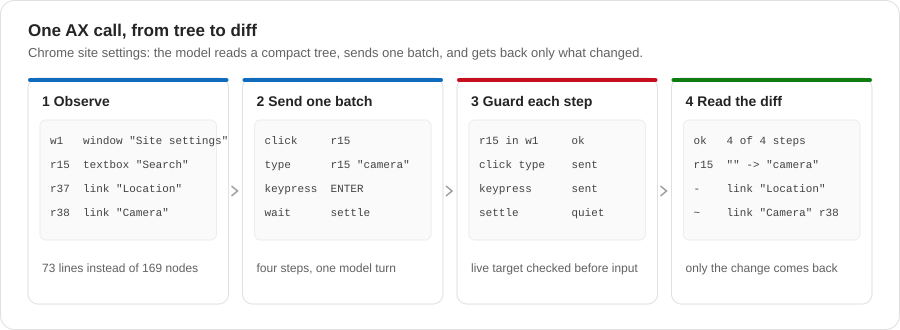

# Computer Use MCP

`computer-use` is a stdio MCP server that controls an already-running
desktop. This page covers building it, running it, configuring Codex and
Claude Code, the public contract and troubleshooting. For the internal design
see [Architecture](ARCHITECTURE.md); for OSWorld evaluation see
[Running OSWorld](OSWORLD.md).

| | |
| --- | --- |
| Executable | `computer-use` |
| Transport | stdio, newline-delimited JSON-RPC |
| MCP protocol versions | `2025-03-26` and `2025-06-18` |
| Public tools | `AX` and `GUI` |
| Version | the repository `VERSION` file, reported by `--version` and `serverInfo.version` |

One `computer-use mcp` process serves one desktop session. It starts one
persistent platform provider and keeps AX snapshots, element references and the
GUI layout lease in memory, so never share a process between benchmark tasks.

## Source layout

The Go module lives in `computer-use/`: `cmd/computer-use` holds `main()`,
`internal/contract` the published schemas, `internal/core` the service,
`internal/provider` the platform backends and `internal/transport` MCP, the
daemon and the CLI. The native providers live in `native/{linux,macos,windows}/`.
[Architecture](ARCHITECTURE.md#go-packages) lists every package and file.

## Build

```bash
make build-local  # Linux binary in artifacts/computer-use (Go 1.22+)
make smoke        # initialize, list tools, require exactly AX and GUI
```

`make build-local` builds `./cmd/computer-use` with `CGO_ENABLED=0` for
linux/amd64 and injects the version from `VERSION` with
`-X main.version=...`. A plain `go build` reports `dev`.

`make build-local` builds Linux. [Platform support](PLATFORMS.md) covers
the macOS app bundle, Windows self-contained executable, and permissions.
When redistributing a build, include its `LICENSE`, `THIRD_PARTY_NOTICES.md`
and `licenses/` directory alongside the executable. The Linux output directory
can also contain downloaded agent CLIs; those are separate dependencies, not
part of the Computer Use package.

## Desktop runtime

Run the server as the signed-in desktop user. On Linux, bind its environment:

```text
DISPLAY
XAUTHORITY
XDG_RUNTIME_DIR
DBUS_SESSION_BUS_ADDRESS
GTK_IM_MODULE
QT_IM_MODULE
XMODIFIERS
```

The provider needs Python 3 with PyGObject and the AT-SPI, GTK and GdkPixbuf
typelibs, plus `xdotool`, `wmctrl` and `x11-utils`. The IBus typelib and
packages are optional; they enable input-method keyboard typing. On Debian or
Ubuntu:

```bash
sudo apt-get install python3 python3-gi gir1.2-atspi-2.0 gir1.2-gtk-3.0 \
  gir1.2-gdkpixbuf-2.0 gir1.2-ibus-1.0 ibus ibus-gtk ibus-gtk3 \
  xdotool wmctrl x11-utils
```

When `DISPLAY`, `XDG_RUNTIME_DIR` or `DBUS_SESSION_BUS_ADDRESS` is missing,
for example under `docker exec`, the server finds the same user's session
from `/run/user/<uid>` and the desktop processes.

AX editable-text writes use the application's accessibility interface when
it is available. Keyboard text is typed in one of two ways:

| Desktop state | Non-ASCII characters | Line feed and tab |
| --- | --- | --- |
| IBus Simple input context active, normally the desktop's `xkb` input source | Composed through the input method | Composed as text characters |
| No IBus Simple input context | Typed as key events, one character at a time | Typed as Enter and Tab keys |

ASCII text without line feeds or tabs is typed as key events on both
desktops. When AX falls back to keyboard typing, its note says which way the
text was typed. GUI results do not include notes.

To use the input method, applications must inherit the desktop's
input-method environment. Existing application processes may need a restart
after that environment is corrected.

Input-method keyboard typing waits for the input method to acknowledge composition,
each hex digit and each committed character. It does not change the clipboard or input
source. If the input context cannot compose text, the operation stops. Failure
after the initial `Ctrl+Shift+U` prefix reports partial input and can leave a
visible preedit. Inspect the field before retrying; the provider does not
send an automatic Escape that could cancel unrelated application state.
The provider does not retry partial input-method text with key events.
Commit acknowledgements prove input-method delivery, not the resulting field
contents. Applications can filter literal control characters such as line feeds
and tabs. The input method composes these characters as text; it does not replace
them with Enter or Tab keys. Use `keypress` when the intended operation is an Enter or Tab key,
and inspect the resulting application state.

Without the input method, each non-ASCII character uses a temporary X keymap
binding, and the provider waits 35 ms after each one so that the application
reads the binding before the next character reuses it. A call accepts at most
500 non-ASCII characters. An Enter or Tab key keeps its normal effect in the
focused control, for example submitting a form or moving focus. Text that
contains NUL or an unpaired surrogate fails before any input on this path.

### Accessibility on Linux

Applications started by the user need no accessibility flags or
environment scripts. On its first request the Linux provider switches
session accessibility on, the way a screen reader does at login:

1. It sets `org.a11y.Status.IsEnabled` on the session bus. This starts the
   AT-SPI bus if needed and stores `org.gnome.desktop.interface
   toolkit-accessibility true` in the user's settings.
2. On Xfce, it adds `gail:atk-bridge` to the XSETTINGS value `Gtk/Modules`
   through Xfconf. On GNOME, the settings daemon does this itself.
3. It reads the attributes of each AT-SPI application once. Chromium and
   Electron build their tree below the window frame only after this
   screen-reader signal.

It never sets `ScreenReaderEnabled`, because on GNOME that starts Orca.
Sessions that already have accessibility on see only reads.

| Toolkit | Started after the provider | Already running when the provider starts |
| --- | --- | --- |
| GTK 3, GTK 4 (including LibreOffice with the gtk3 plugin) | Visible | Visible |
| GTK 2 (GIMP) | Visible | Visible within seconds when an XSETTINGS manager runs (Xfce, GNOME) |
| Qt 5.15 and later, Qt 6 (VLC, Kate, Okular) | Visible | Not visible; restart the application |
| Qt before 5.15 (WPS Office 11 bundles Qt 5.12) | Not visible; start it with `QT_LINUX_ACCESSIBILITY_ALWAYS_ON=1` | Same |
| Java Swing and AWT (GeoGebra Classic 5) | Not visible; start it with the Java ATK wrapper (below) | Same |
| Gecko (Firefox) | Visible | Not visible; restart the application |
| Chromium, Electron (Chrome, VS Code, Joplin, XMind) | Visible | Not visible; quit every window and start it again |

`AX {"mode":"apps"}` names each titled window whose process is not on the
accessibility bus, with its toolkit and the restart that makes it visible.
Until the restart, only GUI can read and operate that window. The same note
covers a process that is on the bus only through another toolkit: WPS
Office loads GTK for its Qt theme plugin, GTK registers an empty
application, and the Qt windows stay off the bus. Windows that an
application on the bus shows outside its tree, such as the native message
boxes of Electron applications, are listed as `wN` without a tree.

Qt before 5.15 reads only `ScreenReaderEnabled`, not `IsEnabled`, so it
needs `QT_LINUX_ACCESSIBILITY_ALWAYS_ON=1` in its environment at launch.
The provider does not set `ScreenReaderEnabled` (see above).

Java applications export a tree only through the Java ATK wrapper (Debian
and Ubuntu packages `libatk-wrapper-java` and `libatk-wrapper-java-jni`).
Start the application with these Java options:

```sh
JDK_JAVA_OPTIONS="-Djavax.accessibility.assistive_technologies=org.GNOME.Accessibility.AtkWrapper \
  -Xbootclasspath/a:/usr/share/java/java-atk-wrapper.jar \
  -Dsun.boot.library.path=$JAVA_HOME/lib:/usr/lib/x86_64-linux-gnu/jni"
```

`JAVA_HOME` is the runtime the application starts, which can be a runtime
bundled with the application. Use `JDK_JAVA_OPTIONS`, because some launch
scripts unset `JAVA_TOOL_OPTIONS` (GeoGebra's does). The wrapper class loads
from the boot class path, so its native library must be on the boot library
path; `java.library.path` is not searched for it.

Some windows stay GUI-only although `apps` lists them, and AX can still
activate, close and wait for them:

- Applications that draw their own interface export no tree: Blender,
  REAPER (its controls are drawn on plain GDK windows) and canvas games.
- MuseScore 4 answers most child slots of its Qt Quick windows with null
  references. The tree shows their count as `/null-children` on the parent.
- When a modal dialog of the same application is open, `activate` of the
  window behind it fails with `window_blocked` and names the dialog to
  answer or close first.

A new Firefox profile opens a Terms of Use dialog over its first tab.
Until the dialog is accepted, Firefox exposes only the dialog, so `find`
and `select` see no page content. Images that start Firefox with a new
profile should set the enterprise policy `SkipTermsOfUse` in
`distribution/policies.json` of the Firefox installation:

```json
{"policies": {"SkipTermsOfUse": true}}
```

On other desktops, applications started before the provider may also need
a restart. A GTK 2 application without an XSETTINGS manager needs
`GTK_MODULES=gail:atk-bridge` at launch. LibreOffice exposes a tree only
with a GTK VCL plugin; set `SAL_USE_VCLPLUGIN=gtk3` where it chooses
another one.

The provider also sets `GDK_SCALE=1` for its own process, so GUI
screenshots and input use X root pixels when the desktop scales windows.

OSWorld guests source `/home/user/a11y-env.sh` before the agent starts.
The script sets the same switches at launch time and stays compatible.

The server speaks MCP on stdout. A wrapper must never print to stdout; send
diagnostics to stderr.

## Command line

```text
computer-use mcp               start the stdio MCP server
computer-use call AX|GUI       call one tool, or a JSON array of calls with --calls
computer-use doctor            print platform runtime requirements
computer-use version           print the version
computer-use help [command]    general help, or help for mcp, call or cli
```

`call` runs the same core as an MCP client in its own process and prints the
same model-facing result, with images written to files; it is useful for
diagnostics. Refs do not survive between `call` processes. The daemon,
`schema`, `batch` and the shorthand commands (`apps`, `find`, `click`, ...)
keep refs across commands; [Code entry points](CODE.md#command-line)
describes them.

```bash
computer-use call AX --args '{"mode":"apps"}'
computer-use call GUI --args '{"actions":[{"type":"screenshot"}]}'
computer-use call GUI --args '{"actions":[{"type":"zoom","region":[600,60,680,100]}]}'
```

`call` runs one process per command, and a zoom needs a GUI frame in the same
process. A lone `call GUI` zoom therefore takes a fresh screenshot and fails
with `gui_frame_stale`. Use `--calls` to send the screenshot and the zoom
together, or use the daemon commands, which keep the frame across commands.

## Codex

The runner writes a task-local `config.toml`; its MCP section is below. The
same section works in an existing `~/.codex/config.toml`:

```toml
[mcp_servers.computer_use]
command = "/path/to/computer-use"
args = ["mcp"]
required = true
startup_timeout_sec = 60
tool_timeout_sec = 180
```

To generate the Codex tool profile and selected interaction guide outside OSWorld:

```bash
python3 -m hcu.render_agent_config --agent codex \
  --model gpt-5.5 --effort xhigh \
  --gateway http://127.0.0.1:8611 \
  --mcp "$PWD/artifacts/computer-use" \
  --instructions-file "$PWD/instructions/hybrid.md" \
  --base-instructions "$PWD/instructions/base.md" \
  --codex-home /tmp/codex-home \
  --output /tmp/codex-home/config.toml

CODEX_HOME=/tmp/codex-home codex
```

The standalone configuration embeds the selected `--instructions-file` text in
`developer_instructions`; it does not write or overwrite a workspace
`AGENTS.md`. The OSWorld runner continues to inject its task-local `AGENTS.md`
inside the disposable guest. Set `--codex-home` to the home the client will
actually use so bundled-skill paths match. Local generation does not reproduce
guest isolation or grant permission to automate the desktop.

Standalone Codex configurations use `approval_policy = "on-request"` and
`sandbox_mode = "workspace-write"`. Shell commands run within the workspace
sandbox; the agent can request approval for elevated access. This is not an
approval prompt for every action. Review the working directory before starting
Codex, since workspace files can be changed without an escalation.
Use the interactive `codex` command for approval prompts. Non-interactive
`codex exec` can disable approval prompts even when this config requests them;
it retains the selected shell sandbox but cannot ask for elevated access.

The launch command above adds no permission overrides. Codex CLI options such
as `--dangerously-bypass-approvals-and-sandbox`, `--sandbox danger-full-access`
or `-c approval_policy=never` can override these defaults. Do not add them to
standalone launch scripts. `--ignore-user-config` skips the generated config;
`--profile` can layer different permissions over it.

The shell sandbox does not isolate the MCP server or the desktop it controls.
Use a dedicated desktop or disposable VM for untrusted tasks, keep sensitive
applications and credentials out of that session, and review any client
permission overrides before use. A separate `CODEX_HOME` isolates configuration,
not the operating system.

Python callers of `hcu.osworld.agents.codex_config()` get the same standalone
defaults. Only an externally isolated, disposable evaluation guest should use
`execution_context="isolated-guest"`; that explicitly selects
`approval_policy = "never"` and `sandbox_mode = "danger-full-access"` for
unattended execution. Guest paths, task IDs and channel selections do not
select this mode. The standalone generator always selects `standalone`.

The guide is always injected plain text, not a discoverable or activated
skill. `--instructions-file ""` omits the guide but retains base policy;
`--base-instructions` selects that policy. Product instruction files contain no runner protocol
markers. See [Running OSWorld](OSWORLD.md#isolation-and-instructions) for the
shared policy and profiles.

The profile turns off Codex's built-in `computer_use` feature, so desktop
input comes only from this server, the shell or the browser runtime. See
[Running OSWorld](OSWORLD.md#isolation-and-instructions) for the harness
profiles.

### Codex code mode

With `--code-mode` (`"code_mode": true` in a queue config), the model gets
only Codex's code tool. The MCP server stays registered, and code calls it
as `tools.mcp__computer_use__AX` and `tools.mcp__computer_use__GUI`. The
switch turns on `code_mode`, `code_mode_only` and `code_mode_host`, adds
`omit_tools_from = ["deferred"]` to the server entry, and appends
`instructions/hybrid-code.md` to the selected profile:

```toml
[features]
code_mode = true
code_mode_only = true
code_mode_host = true

[mcp_servers.computer_use]
command = "/path/to/computer-use"
args = ["mcp"]
required = true
startup_timeout_sec = 60
tool_timeout_sec = 180
omit_tools_from = ["deferred"]
```

Some Codex versions defer MCP tools in code mode: the tools stay callable,
but their declarations are left out of the code tool description.
`omit_tools_from = ["deferred"]` keeps them in; versions that do not defer
MCP tools ignore the key. Some model metadata selects code mode by itself;
the switch then still keeps the declarations and the guide. The command
line and the Python SDK remain the fallback for code runtimes without MCP.
See [Code entry points](CODE.md#codex-code-mode).

## Claude Code

Claude Code connects through `hcu/osworld/guest_files/claude_mcp_schema_adapter.py`.
The adapter flattens only the schemas it shows Claude; the server still
validates the original schemas before any side effect. To add the server to
an existing Claude Code setup:

```bash
claude mcp add computer_use -- python3 \
  /abs/path/to/hcu/osworld/guest_files/claude_mcp_schema_adapter.py \
  /abs/path/to/artifacts/computer-use mcp
```

The generated profile writes the equivalent JSON:

```json
{
  "mcpServers": {
    "computer_use": {
      "type": "stdio",
      "command": "/absolute/path/to/python",
      "args": ["/path/to/claude_mcp_schema_adapter.py", "/path/to/computer-use", "mcp"]
    }
  }
}
```

`python3 -m hcu.render_agent_config --agent claude-code ...` writes this file,
the replacement system prompt and a `.launch.py` startup script. It selects the Python interpreter running
the generator. On Windows, run the generator with the local Python installation;
the generated executable and adapter paths are native paths. Keep that Python
installation available when launching Claude. The Linux guest runner retains
its guest-specific Python path. The runner allows the tools `Bash`,
`Edit`, `Read`, `mcp__computer_use__AX` and `mcp__computer_use__GUI`.

For a standalone session:

```bash
python3 -m hcu.render_agent_config --agent claude-code \
  --model claude-opus-5 --effort xhigh \
  --gateway http://127.0.0.1:8537 \
  --task-id manual \
  --mcp "$PWD/artifacts/computer-use" \
  --output /tmp/hcu-claude/mcp.json

python3 /tmp/hcu-claude/mcp.launch.py
```

The script requires `claude` on `PATH` and forwards additional CLI arguments.
It supplies the selected model and effort, the task-scoped gateway URL,
placeholder authentication, MCP configuration and replacement prompt. Loading
the MCP JSON alone does not apply these startup settings. Local sessions use
manual tool approvals, not the disposable guest's permission bypass; generation
does not reproduce guest isolation.

`python3 -m hcu.render_agent_config` also renders the Gemini CLI and Grok
Build profiles (`--agent gemini-cli`, `--agent grok-build`), writing the
settings or config file plus the files each harness reads instead: a global
`GEMINI.md` and an experiments file for Gemini CLI, a system prompt for Grok
Build. `--channels a11y,keyboard` or `gui,keyboard` renders the one-channel
ablation for any agent.

## Gemini CLI and Grok Build

Both register the same server directly, without an adapter. Gemini CLI reads
the `computer-use` entry under `mcpServers` in its `settings.json` and is served by
`hcu.gateway.gemini_proxy`; Grok Build reads `[mcp_servers.computer_use]` from
its `config.toml` and is served by `hcu.gateway.openai_proxy` on the Responses
API. [Running OSWorld](OSWORLD.md#isolation-and-instructions) describes the
rest of each profile.

For Gemini, `--output` must be `<home>/.gemini/settings.json`, for example
`/tmp/hcu-gemini/.gemini/settings.json`. Other layouts are rejected before
writing configuration. The generator prints the required environment, including
`GEMINI_CLI_HOME=<home>` and absolute paths for the base prompt and experiments
file. Apply those environment variables when starting `gemini`; its global
`GEMINI.md` is written beside `settings.json`. An arbitrary JSON filename is not
a discoverable Gemini configuration.

The Gemini server key avoids underscores because its policy parser uses an
underscore to separate server and tool names. Other client keys are unchanged.
When adding another client, verify that it preserves the `oneOf` GUI schema,
forwards PNG bytes on both normal and `isError: true` tool results into the
next model request, and keeps one persistent MCP process per desktop session.

## Public contract

The exact schemas and descriptions are in
`computer-use/internal/contract/tool_contract.go`; `computer-use schema`
prints them with the error table. This section describes behavior that the
schemas cannot express.

<p align="center">
  
</p>

### AX modes and refs

`AX` takes a `mode`: `apps`, `observe`, `find` or `act`. The server owns an
identity graph:

```text
application aN -> top-level window wN -> element rN
```

- `apps` lists confirmed top-level windows as `wN` with title, application and
  whether it has focus. Output names applications but shows no `aN`; `app`
  still accepts an `aN`, a name, an app id or a PID.
  If an application does not answer, the listing retains confirmed windows
  and reports `inventory_complete=false` with `inventory_issues` in text and
  records output. Each issue names the application when known and gives the
  read failure. Missing windows remain unknown. Returned refs remain usable;
  title-based selection, implicit focus, and window waits require a complete
  listing. A missing window cannot prove that a close succeeded.
- `observe` returns a window tree or a diff with `rN` refs; `find` returns
  matching `rN`, and a truncated result prints the call for the next page.
- References describe current state; they are not durable selectors. Every
  mutation resolves its reference against the live accessibility tree again
  and rejects stale or cross-window targets before any input.

Observe and find with `scope:"content"` use the whole window when a dialog
or a window has no unique content area. The result states why the scope
expanded. Find and query waits accept the roles and states shown in the tree.
A zero-result find lists at most five nearby candidates; these suggestions
do not change the query or send input.

A table cell whose value differs from its name shows the value after the
name, for example `cell "A1" = "Year"` in a spreadsheet, where cells are
named by address. The tree shows at most 40 Unicode code points of it, plus
an ellipsis when clipped. When a tree exceeds its budget, a long run of
sibling elements loses elements from its end first, so a table keeps its
first rows; one `/omitted: "budget nodes=N ..."` line counts the rest.

Output pruning differs from content that the provider could not read.
For an incomplete read, `coverage:"partial"` includes an `acquisition`
object with `reported_missing_nodes` and `reasons`. The count sums reported
gaps; an unread branch can contain more nodes than the provider could count.
`recover.structural_budget` describes output pruning, while
`recover.acquisition` describes unfinished reads. Text and records output
preserve the same acquisition evidence. Cached find pages retain the evidence
from their original read; a resumed provider read supplies new evidence.
`find` or a subtree root can narrow the read but cannot guarantee that an
unread region becomes available. GUI can show content that accessibility
could not read.

Find matches include a `text` excerpt when their role's value is absent from
the rendered fields, as with paragraphs and clipped cell values. The excerpt
contains at most 80 Unicode code points, plus an ellipsis when clipped.
Clipped excerpts also carry `text_truncated=true`. Text already displayed in a name, property,
or matched-text field is not repeated. Excerpts are display-only and do not
change canonical text, selectors, refs, or the response budget.

### `act` steps

- `act` accepts up to 64 ordered steps: actions
  `{type, ref|title, text|keys|value|direction|pages|to_ref}` and `wait`
  steps. Argument errors reject the whole batch before input. The first step
  that fails stops the batch, and the result says how many ran.
- The `rN` or `wN` refs name the window, so an `act` call with refs needs no
  `window_ref`. `window_ref` only sends ref-less `keypress` and `type` to a
  window other than the focused one. `keypress` and `type` without `ref` go
  to the window that had focus when the call started.
- `activate` and `close` accept a window title substring, resolved to one
  `wN` before any input.
- The decoder accepts `type.value` as `type.text` and non-empty
  `set_value.text` as `set_value.value`. Supplying both fields is rejected
  before input. The published schema advertises only the canonical names.
- `observe` selects the evidence returned after the batch. The default is a
  compact `diff`. An explicit `tree` returns the complete final window tree,
  and `full` also returns a screenshot. These requests have the same
  meaning after a mutation, an ordered input sequence, or a final wait;
  evidence is captured after the wait finishes.
- The removed `until` field, and its older spellings `postcondition` and
  `assertion`, are rejected before any input. The hint is the same call
  rewritten with `wait` steps.

### `wait` steps

A `wait` step sends no input. The sum of all wait timeouts in one `act` must
not exceed 60 seconds; an omitted `timeout_ms` counts as 5000. This bounds
waiting only, not total call duration. The forms are:

| Form | Holds when |
| --- | --- |
| `window` | A top-level window whose title contains the text exists. It is read from the whole desktop, so another process or a relaunched application counts. |
| `query` | An element in any visible window of the batch's application, including dialogs and popups, matches as `find` matches. |
| `ref` with `value`, `state` or `text` | That one element has the value, state or text. |
| `text` alone | The text appears anywhere in the batch window. |
| `settle:true` | The UI changed after the input step before the wait and then stayed the same for 0.4 s. |

`settle` needs no prediction of the next state. Use it after an action that
changes the UI when you do not know what the UI becomes, for example the
title of the dialog it opens. A change is a window that opens, closes or
changes its title, focus that moves to another window, a change in the tree
of the batch window (of the window that took focus, once focus moved), or a
pixel change that the action's own readback reports. Keyboard focus that
moves inside one window, and a press or hover on an element, do not count: a
click sets them even when the application ignores it. Each poll reads the
window list and one window tree. On Linux the provider reuses an unchanged
tree when the application sent no accessibility event, so the polls are
cheap while the UI is quiet. The step's line names what changed: opened and
closed windows, the focus move, and the number of tree nodes that appeared,
disappeared or changed. If nothing changed by the timeout, the step fails
with `wait_timeout` and says "no change", because the steps after it assume
a change. A UI that keeps changing, such as a clock or a progress bar,
passes at the timeout with a note. An action whose result looks the same as
the state before it, such as reloading an unchanged page, reports no change.
The wait returns at the first quiet period, so content that arrives later
than 0.4 s after the first change, such as a page that fills in a list after
it loads, can still be missing; wait for it with `text` or `query`. A slow
operation, such as opening a large file, can take longer than the default
5000 ms; give it a longer `timeout_ms`. `settle` must follow an input step
of the same `act` and takes no `gone`.

`gone:true` waits for absence; an exited application has no window. On
timeout the step fails with `wait_timeout`, the message says what was seen or
why the state could not be read, and the current window refs and nearby
elements follow before diagnostic detail. A read that is incomplete keeps
polling until the timeout, and a failed window read never proves that a
window closed. After a `window` wait, keys and text without `ref` go to that
window. After a `settle` wait that saw focus move to another window, they go
to that window. An `act` with only `wait` steps waits without input.

A wait timeout is an execution failure, including when the first step sends
no input. A preflight rejection occurs before execution. A successful wait proves its
declared condition; it does not replace a failed final observation or prove
that an exact window identity disappeared from a title match alone.

If a final observation fails after a successful action, `input_emitted` still describes
the action. The response labels the failed read as a read-only follow-up and
retains `observation_failure_code` and `observation_required`. A no-input
statement inside that follow-up describes the read, not the earlier action.
Stale-window follow-ups report the unavailable source reference without
repeating an input-delivery statement.

### `select` steps

A `select` step selects without typing or clicking:

- `{"ref":"rA"}` selects the whole element, or the item in a list.
- `"text"` selects that exact substring of `rA`; it must occur once.
- `"to_ref":"rB"` selects from the start of `rA` through the end of `rB`, for
  two cells of one table or two sibling text elements such as Writer
  paragraphs.
- On a combo box or list box, `"text"` chooses the option with that name. On
  an option of an open combo box popup, `{"ref":"rA"}` chooses that option.
  A combo box that names itself after its choice, as in GTK and Qt, must
  show the option afterwards; a Qt popup is committed by moving its current
  item to the option and pressing Return.

The provider reads the selection back and reports it as a note, for example
`[select] selected 4 cells A2:B3`. It fails with `effect_unknown` when it
cannot read back what it asked for. On Linux, text across paragraphs is
selected with the caret at the start of `rA` and `ctrl+shift+Down`, because
AT-SPI selects inside one object only. A shifted or oversized selection, or a
cell set that differs from the requested range, fails with `effect_unknown`;
the result reports possible partial input. Native provider differences are in
[Platform support](PLATFORMS.md#ax-selection-and-editable-controls).

### `act` results

Every `act` result that sent input starts, after the evidence line, with a
report built from the reads the call makes anyway:

```text
effect: r58 checkbox "Interface" checked=false→true
windows: opened w5 "Insert Sheet" (dialog, focused); closed w3 "Print"; focus w2
```

There is one `effect` line per action with an element `ref`. It compares the
element in the read before that action with the next read after it and names
the role, the name, and the state or value fields that changed. When both
reads are of the same window and nothing else in it changed, the line ends
with `(only state flags changed in this window)`. When the element itself did
not change but other nodes did, the line counts them, for example
`itself unchanged; 25 nodes appeared under it, 1 node changed elsewhere`.
Nodes that appear or disappear under the element count as its effect; changes
elsewhere do not. The line says `no visible change` when nothing in the window
changed, `gone` when a complete read no longer has the element, and
`unknown (reason)` when no read after the action covers it. The `windows`
line compares the application's top-level windows before the first action
with those after the last; new windows get a `wN` at once. When the report
shows every targeted element changed, or a `wait` after the last action held,
the evidence line does not also say `effect_unknown`.

Removed diff lines omit refs and addressability markers because those lines
describe prior state. Their absent refs appear separately in `absent_refs`.
Three or more consecutive absent refs use an inclusive range: `r40..r43`
means `r40`, `r41`, `r42`, and `r43`. A gap or a ref still present in the
current snapshot breaks the range. Absence from this snapshot does not by
itself prove that the object was destroyed.

An unchanged-tree response requires the delivered refs to match as well as
the provider state. Reissued refs cause a fresh tree delivery. An explicit
`observe:"full"` returns the tree on the first request.

On Linux, a visible composite drop-down can represent both a list toggle and
an editable field. A click addresses the toggle; text editing addresses a
unique editable partner in that same control and verifies its value there.
The editing capability and partner identity must still be valid before input.
A list-only control does not become editable merely because its displayed
role is `combobox`. Missing, ambiguous, or replaced editing targets do not
receive synthesized keyboard input through the toggle.

### Errors

Every AX and GUI result starts with one JSON line: `ok`, and on failure
`code`, `path`, `message` and `hint` (a corrected call), then
`input_emitted`, `completed` and `requested`. The public codes are:

| Code | Tool | Input may have been sent | Next step |
| --- | --- | --- | --- |
| `invalid_argument` | AX, GUI | no | Fix the argument named by `path`; `hint` is a corrected call. |
| `stale_ref` | AX | no | Observe or find again and use the new ref. |
| `gui_frame_stale` | GUI | no | Take a new screenshot and plan coordinates from it. |
| `wait_timeout` | AX | maybe | Observe again; `completed` counts the steps that ran. |
| `window_changed` | AX, GUI | maybe | Observe before retrying; do not repeat the batch blindly. |
| `effect_unknown` | AX, GUI | maybe | Observe before retrying; input may have taken effect. |
| `app_unavailable` | AX | no | List apps; the application is not running or not accessible. |
| `ambiguous_window` | AX | no | Use a longer title or the `wN` from `apps`. |
| `window_not_found` | AX | no | List apps and use a `wN` or an exact title. |
| `no_focused_window` | AX | no | Activate a window first or pass `window_ref`. |
| `permission_denied` | GUI | no | Restore the operating-system permission and restart the provider. |
| `runtime_error` | AX, GUI | maybe | Retry reads later; observe before retrying input. |

`PublicErrorCodes` in `internal/contract/contract_describe.go` is the source
of this table; the CLI exit statuses come from it too.

Recovery follows the concrete failure, `input_emitted`, `completed`, and
`retry_same_request`. A coordinate ownership failure requests a new GUI
screenshot; refreshing an AX ref does not establish that the point belongs
to its window. A window-change hint uses an available current window ref or
requests a GUI screenshot for an anonymous popup. It does not invent a
window title or instruct the caller to repeat already completed steps.

`permission_denied` means the operating system denied access. Its hint gives
permission-recovery instructions instead of another call. Restore the current
provider's permissions and restart it before observing again. When capture
fails after input, the result retains its partial or uncertain input evidence;
restoring permission does not authorize replaying the actions.

### GUI

`GUI` takes an ordered `actions` array. A call with exactly one `screenshot`
or `zoom` action observes. Any other call is an input batch of up to 64 `click`,
`double_click`, `move`, `drag`, `scroll`, `type`, `keypress` and `wait`
actions, and returns one final screenshot. `wait` is one second without an
observation, at most 20 seconds per batch. `settle_ms` (default 800, at most
3000) sets how long the final screenshot waits for visual stillness.

Every provider scales the screenshot to fit within 1366x768, the size the
model sees. `x` and `y` are pixels of the latest returned image and are
mapped back to the native desktop per axis. A screenshot establishes a
private layout lease for the full desktop; a coordinate action fails before
input with `gui_frame_stale` when the window under one of its points no
longer matches the screenshot. Nothing is sent, and the result carries a
fresh screenshot.

<p align="center">
  
</p>

An AX image (`observe:"full"` or `observe:"screenshot"`) is the same
full-desktop frame. The core captures it through the GUI batch after the AX
read and registers it as the current GUI frame, so `x` and `y` may come from
it and a following GUI call needs no new screenshot. The AX result states
the image size on a line before the image.

`{"actions":[{"type":"zoom","region":[x0,y0,x1,y1]}]}`, alone in a
call, returns an enlarged region of the current GUI frame to read small text
and icons. The region is in frame pixels, and each side is at least 8 pixels.
Zoom only looks: it sends no input, and its image never becomes a frame. The
result states the frame, the region snapped to native pixels, and the mapping
`x = x0 + u/scale_x, y = y0 + v/scale_y`, which uses a separate scale for each
axis. GUI `x` and `y` are still frame pixels, and the point rule checks them
against that frame. Zoom fails with `gui_frame_stale` and a fresh screenshot
when there is no frame, or when any window over the region changed since the
frame. Linux, macOS and Windows implement the same geometry, pinned by
`testdata/contract/zoom_geometry.json`, which every provider test replays.
A zoom result's evidence line carries the same mapping as data:
`"zoom":{"frame","region","width","height","scale_x","scale_y"}`.

Every GUI result starts with the same JSON line as AX, followed by `screen`
(the returned image's size and coordinate space) and `actions` (pixel-change
and settle facts); the screenshot follows as an image.

On Linux, the provider captures raw pixels and samples the desktop layout
before encoding an image:

- A screenshot-only call uses one captured frame. A mutation batch retains
  its pre-action frame for failure evidence and encodes its final frame for
  delivery. Layout-race retries discard raw captures without compressing
  them. Encoded images are cached only within the current call.
- PNG uses lossless compression level 3. If its base64 size would exceed the
  image budget, the provider tries JPEG qualities 85, 70, 55, and 40. If no
  encoding fits, the smallest image is returned. Returned MIME and dimensions
  describe the actual image.
- Coordinate actions recheck the live layout before each coordinate input. A
  layout change rejects a coordinate only when the window under that point
  changed: another window is now topmost there, or that window moved,
  resized or closed. Capture failure before dispatch prevents input.
- After an action failure, the provider attempts a fresh capture. If final
  capture or encoding fails, the response labels any pre-action fallback
  explicitly. If neither image is available, the response reports unknown
  visual state.

### What evidence proves

AX evidence covers only what the accessibility tree shows, and GUI evidence
only the returned pixels and reported input delivery. Neither proves file
contents, persistence or network state; agents should verify those through
the shell or the application.

## Environment variables

| Variable | Effect |
| --- | --- |
| `COMPUTER_USE_CHANNELS` | comma-separated channels to expose (`a11y`, `gui`, `keyboard`); all by default. Disabled tools disappear from `tools/list`. |
| `COMPUTER_USE_STRUCTURED_CONTENT` | `1` adds `structuredContent` to tool results. Default off: evidence stays in text because some clients replace sibling text with the structured object. Enable only with a tested consumer. |
| `COMPUTER_USE_ERROR_CONTEXT` | `off` stops capturing fresh UI state after a failed call |
| `COMPUTER_USE_OUTPUT_MODE` | `file` writes large outputs to files and returns their paths |
| `COMPUTER_USE_OUTPUT_DIR`, `COMPUTER_USE_OUTPUT_THRESHOLD` | directory (default `computer-use` in the system temporary directory) and minimum size (4000 characters) for file output |
| `COMPUTER_USE_MAX_INLINE_CHARS` | inline text budget per result, 24000 characters by default |
| `COMPUTER_USE_TRACE_FILE` | append one JSONL line per AX action |
| `COMPUTER_USE_PYTHON_BINARY` | Linux: interpreter for the provider, `python3` by default |
| `COMPUTER_USE_RUNTIME_TIMEOUT_SECONDS` | base provider request timeout, 30 seconds by default |
| `COMPUTER_USE_MACOS_PROVIDER`, `COMPUTER_USE_WINDOWS_PROVIDER` | path of the native provider, instead of the one beside the binary |
| `COMPUTER_USE_WINDOWS_PROVIDER_TRACE` | `1` writes bounded transport stage records to operator stderr; off by default |

The Windows transport trace records startup, worker generations, native calls,
reset responses, and the original request deadline. It omits request contents,
application identity, environment values, and exception messages. Capture stderr
before the first call to diagnose cold startup. The existing nonblocking queue
can drop records if its consumer stalls; a dropped-record event reports that
loss. Tracing does not extend the timeout or change retry rules.

## Troubleshooting

AX lists managed Linux application windows even when their process registers
on the accessibility bus without exporting a tree for every window. Such
windows have a `wN` marked `(no accessibility tree: use GUI)`. AX can activate,
close, or wait for them; GUI reads and operates their content. If an AX root
cannot be matched safely to a native window, the inventory reports incomplete
coverage instead of issuing another reference for that window.

AX sees no applications, or `AX apps` reports windows that are not on the
accessibility bus: restart those applications after the server has run
once (see [Accessibility on Linux](#accessibility-on-linux)). Then check the
session:

```bash
computer-use doctor
gdbus call --session --dest org.a11y.Bus --object-path /org/a11y/bus \
  --method org.freedesktop.DBus.Properties.Get org.a11y.Status IsEnabled
python3 -c 'import gi; gi.require_version("Atspi", "2.0"); from gi.repository import Atspi'
printf '%s\n' "$DISPLAY" "$XAUTHORITY" "$XDG_RUNTIME_DIR" "$DBUS_SESSION_BUS_ADDRESS"
```

GUI observation or input fails:

```bash
xdotool getactivewindow
wmctrl -lpG
```

A client cannot initialize the server:

- check that the configured binary exists and runs `computer-use --version`;
- check that no wrapper writes to stdout;
- run the server as the desktop user, not in a detached root session;
- run `make smoke` outside the desktop to separate protocol problems from
  desktop problems.

When AX reports `stale_ref` or GUI `gui_frame_stale`, take a fresh AX
observation or GUI screenshot instead of repeating the rejected call.
